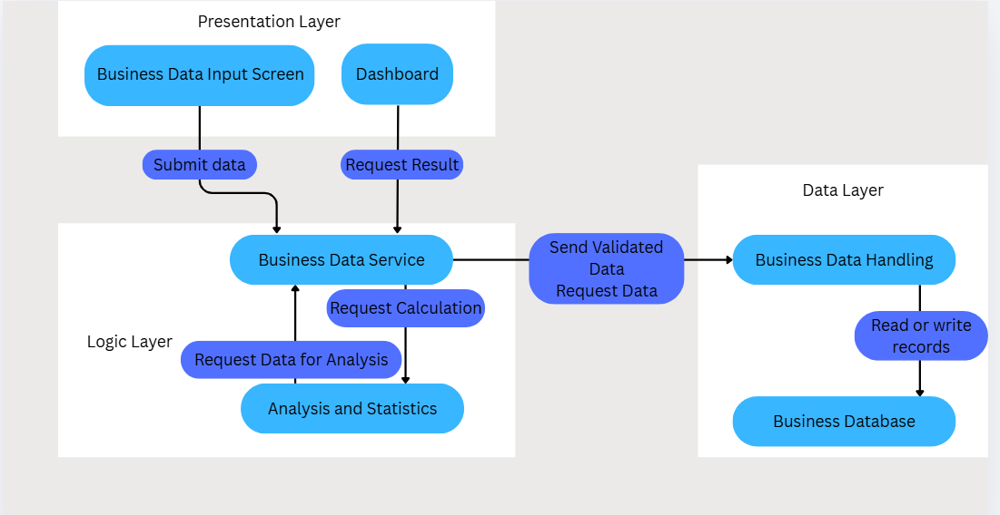

# Week 07 팀 활동지 / Team Activity

| 팀명 / Team | 작성일 / Date | 참여자 / Members |
|---|---|---|
| Null |10/14/2026 | Aizat, Syafiq, Qasim, Farhana|

## 1. 아키텍처 다이어그램 / Architecture Diagram

손그림 사진을 올리고 링크하십시오 / Upload a photo and link it.

| 계층 / Layer | 모듈·파일 / Modules | 의존하지 않는 것 / Does not depend on |
|---|---|---|
| 표현 / Presentation |Business Data Input Screen:form for entering sales and marketing data, with validation messages and save confirmation.Dashboard:charts,tables and messages when data is unavailable|Database type,database queries, and the internal formulas used to calculate statistics |
| 로직 / Logic |Business Data Service:validates submitted data and coordinates saving, retrieval and analysis. Analysis and Statistics:calculates statistics such as total sales and total marketing spending| Screen layout,chart style, or whether the interface is a website or desktop app|
| 데이터 / Data |Business Data Handling:saves and retrieves business , sales, and marketing records. Business Database:stores those records|Screen layout,chart display and business analysis formula |

## 2. 이슈 / Issues

> 이슈 = **앞으로 할 일** / An issue is work to be done.
> 개발할 때 커밋에 이슈 번호를 붙이고(`#3 알레르기 필터 추가`), 완료 조건을 만족하면 이슈를 닫습니다.
> Add the issue number to commits, and close the issue when its criteria are met.

| # | 제목 / Title | 라벨 / Label | 담당 / Assignee | 완료 조건 / Acceptance Criteria |
|---|---|---|---|---|
| 예시 #3 | 알레르기 필터 | backend | 홍길동 | '땅콩'을 선택하면 땅콩이 들어간 메뉴가 추천 결과에서 빠진다 |
|1. |Defining the data structure |  Documentation|Farhana| Required business, sales, and marketing fields are documented and agreed upon by the team|
|2. | Setting up the database |Database/ Backend | Qasim| Business data can be successfully saved to and retrieved from the database using the documented data structure|
|3. |User I/O System |frontend/backend | Syafiq| Users can enter business data through the input interface, submit it, and receive confirmation that it was saved successfully |
|4. |Data Loader |backend |Syafiq|The platform can retrieve the required sales and marketing data from the database for further processing |
|5. |Analytics Implementtation|backend/analytics|Aizat |Retrieved data is processed into the agreed-upon sales and marketing statistics, and the results can be verified against sample data |

## 3. 마일스톤 / Milestones

| 마일스톤 / Milestone | 마감 / Due | 포함 이슈 / Issues |
|---|---|---|
| MVP 완료 | 11주차 |Sales data: data inputs, data retrieval, dashboard and simple statistics, database storage and record) |
| 실행 패키지 | 13주차 |Marketing data: data inputs, data retrieval, dashboard and simple + advanced statistics, database storage and record); Sales data: advanced statistics|

> AI를 사용했다면 `PROMPTS.md`에 기록 / Log any AI use in `PROMPTS.md`
